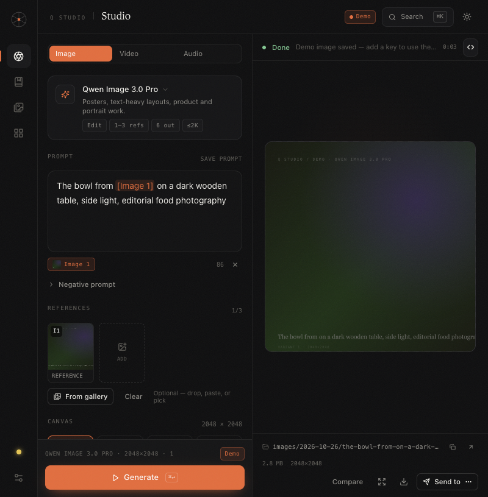
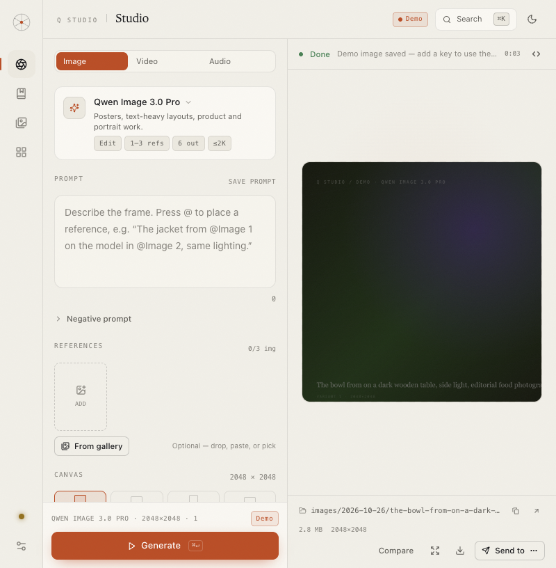
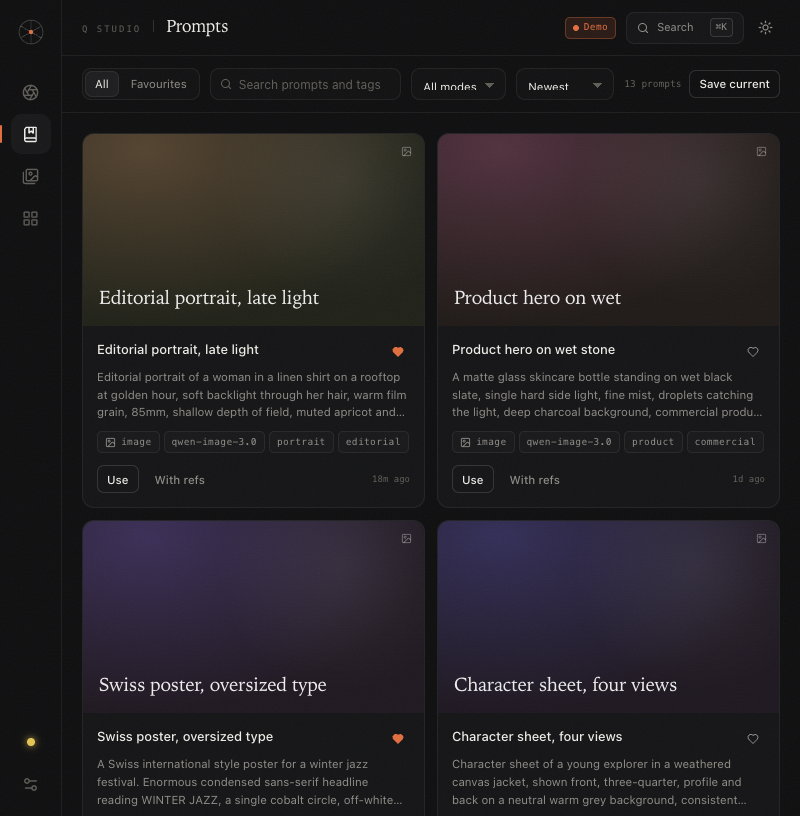
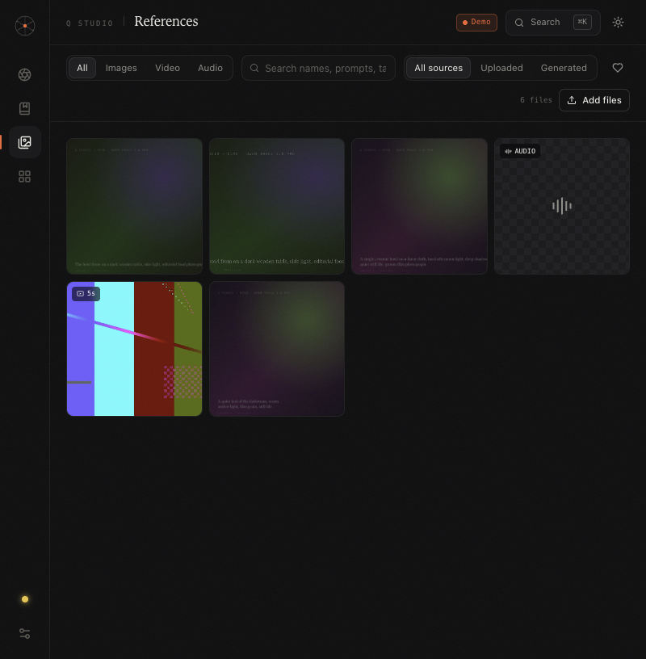
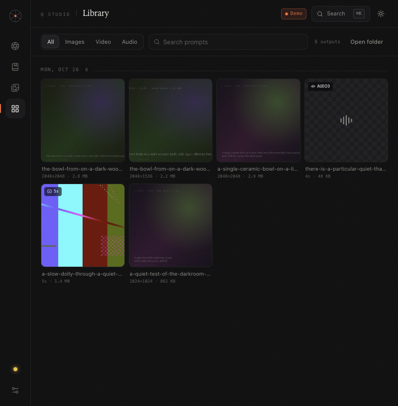
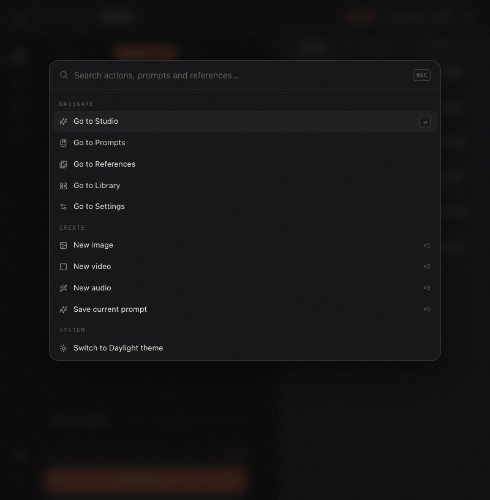
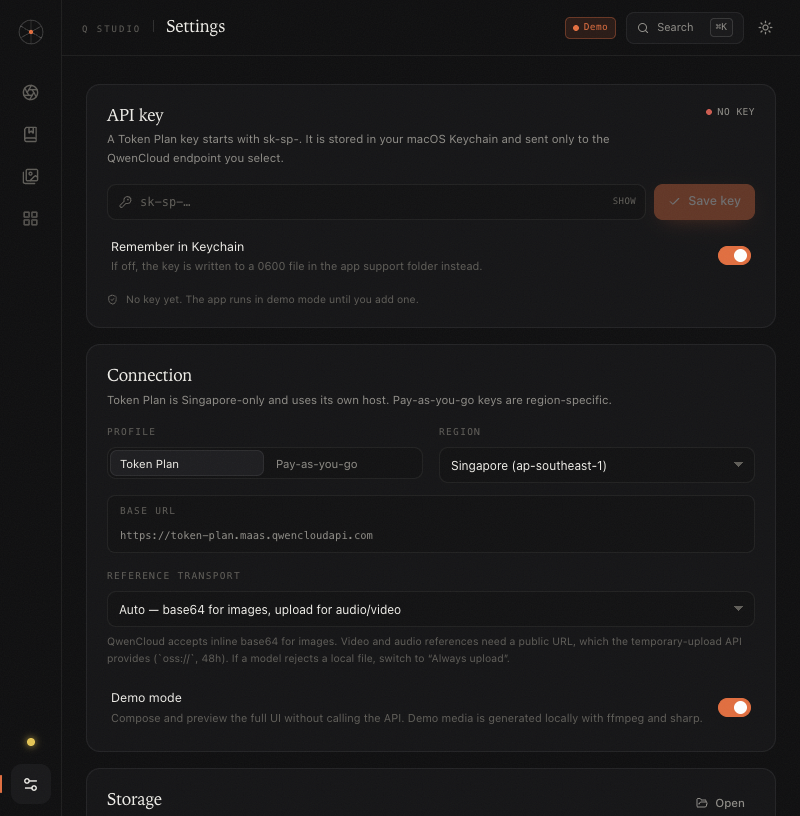

# Q Studio

A local, single-user studio for the QwenCloud **Token Plan** — image generation and editing, video, and speech, with a prompt gallery, a reference library, a film continuity layer, and every output saved to disk with its path attached.



> Runs on `127.0.0.1` only. Your API key goes into the macOS Keychain. No telemetry, no cloud database, no scheduled jobs.

## Contents

- [Requirements](#requirements)
- [Quick start](#quick-start)
- [Configuration](#configuration)
- [The model allowlist](#the-model-allowlist)
- [What's in it](#whats-in-it)
- [How local files become API inputs](#how-local-files-become-api-inputs)
- [Probe the real endpoints first](#probe-the-real-endpoints-first)
- [Storage](#storage)
- [Architecture](#architecture)
- [Token Plan terms — read this](#token-plan-terms--read-this)
- [Verify locally](#verify-locally)
- [Troubleshooting](#troubleshooting)
- [Roadmap](#roadmap)
- [Contributing](#contributing)
- [License](#license)

## Requirements

- macOS (the packaged desktop app targets Apple silicon)
- Node.js 24 or newer
- pnpm 10 or newer
- `ffmpeg` on your `PATH` for demo videos and local film exports (demo images are SVG and need nothing extra)

## Quick start

```bash
pnpm install
pnpm dev
```

The browser opens at **http://localhost:5180**. The API server listens on **127.0.0.1:8799** and is proxied by Vite.
The dev launcher generates a per-launch engine token and the Vite proxy injects
it, so direct unauthenticated calls to the API port are rejected.

On first run you can:

- paste a Token Plan key (`sk-sp-…`) and start, or
- choose **Explore in demo mode** — the entire UI works, with locally generated placeholder media, without spending credits.

### If port 8799 is taken

```bash
QSTUDIO_PORT=8801 pnpm dev
```

The server and the Vite proxy both read `QSTUDIO_PORT`.

### Production build

```bash
pnpm build
pnpm start          # serves apps/web/dist + the API on 127.0.0.1:8799
```

### Desktop app (macOS)

```bash
pnpm desktop:dev    # Tauri window + Vite dev server + engine sidecar
pnpm desktop:build  # .app + .dmg in apps/desktop/src-tauri/target/release/bundle/
```

The desktop build needs no system Node and no system ffmpeg: a Node runtime,
the bundled engine, and a checksum-pinned static `ffmpeg` ship inside the app
(`Contents/Resources/engine/`, see `docs/THIRD-PARTY.md`). The engine binds an
ephemeral loopback port, requires a per-launch token, and stops with the app —
quitting leaves no `node` or `ffmpeg` processes behind. A tray icon can pause,
resume or restart the engine without closing the window. Logs land in
`~/Library/Logs/Q Studio/engine.log` and are viewable in Settings, where
storage can also be pruned (demo outputs, old generations, thumbnails, dead
job records).

The app is unsigned. On first launch macOS may block it:
right-click → Open, or run
`xattr -dr com.apple.quarantine "/Applications/Q Studio.app"`.

## Configuration

Q Studio reads configuration from environment variables; it does not load `.env` files itself. Copy [`.env.example`](.env.example) to `.env` for a template (`.env` is gitignored) and export the values you need:

```bash
set -a; source .env; set +a
```

| Variable | Default | Purpose |
| --- | --- | --- |
| `QWEN_TOKEN_PLAN_KEY` | — | QwenCloud API key. Checked first, before `DASHSCOPE_API_KEY`. |
| `DASHSCOPE_API_KEY` | — | Fallback environment key. |
| `QSTUDIO_PORT` | `8799` | API port. The dev proxy reads the same value. |
| `QSTUDIO_HOME` | platform app-support dir | App-data directory (config, SQLite store, thumbnails). Useful for isolated test runs. |
| `QSTUDIO_TOKEN` | — | Bearer token required on `/api` routes (set by the desktop launcher). |
| `QSTUDIO_KEYCHAIN_SERVICE` / `QSTUDIO_KEYCHAIN_ACCOUNT` | `Q Studio` / `token-plan` | macOS Keychain entry used to store the API key. |
| `QSTUDIO_FFMPEG` / `QSTUDIO_FFPROBE` | from `PATH` | Explicit media-tool paths. |
| `QSTUDIO_DIST` | `apps/web/dist` | Directory served in production mode. |
| `QSTUDIO_LOG` | — | Engine log path surfaced in Settings. |

If no key is present in the environment, the app stores the key you paste in Settings in the macOS Keychain (or a `0600` file if you turn remembering off). The key is never written to the repo, logs, or the frontend.

## The model allowlist

The Token Plan only draws down your subscription for these model IDs. Q Studio hard-codes them, so there is no free-text model field to get wrong.

| Modality | Models | What the UI exposes |
| --- | --- | --- |
| Image | `qwen-image-3.0-pro` | 1–3 refs, ≤2K, 1–6 outputs, negative prompt, thinking, rewrite mode |
| Image | `wan2.7-image` | up to 9 refs, ≤2K, 1–4 outputs, 1–12 sequential sets, brand palette |
| Image | `wan2.7-image-pro` | same as above plus 4K |
| Video | `wan3.0-video` | 2–30s, first/last frame, up to 10 image refs, video/audio refs, edit + extend, native audio |
| Video | `happyhorse-1.1-t2v` / `-i2v` / `-r2v` | 3–15s, 480/720/1080P; r2v takes 1–9 reference images |
| Audio | `qwen-audio-3.0-tts-plus` | 14 curated voices, delivery instructions, emotion tags, MP3/WAV |

Each model's request shape is different, and the app knows it:

- `qwen-image-*` → `/api/v1/services/aigc/multimodal-generation/generation` (sync)
- `wan2.7-*` → `/api/v1/services/aigc/image-generation/generation` (submitted as an **async task**; the Token Plan gateway rejects synchronous calls for this family with `ACCESSDENIED: current user api does not support synchronous calls`)
- video → `/api/v1/services/aigc/video-generation/video-synthesis` (async → poll `/api/v1/tasks/{id}`)
- TTS → `/api/v1/services/audio/tts/SpeechSynthesizer` (handles both JSON-with-URL and raw-audio responses)

## What's in it

### Studio

Three columns: composer, stage, inspector.

- **Composer** — mode tabs, model card, prompt editor with `[Image N]` tokens highlighted, optional references, canvas/ratio controls, output count, duration, voice, and an *Advanced* drawer for seed, watermark, rewriting, thinking and brand palettes.
- **Reference tray** — drag & drop, paste from clipboard, or pick from your library. Reorder to change `Image N`; tokens remap automatically. Each slot can change role: reference, first frame, last frame, audio, video.
- **Stage** — adaptive-aspect preview, honest elapsed timer while running, cancel, filmstrip for multi-output, compare-against-input for edits, focus mode, video player with **Grab current frame** (feeds it straight back as a reference), waveform player for audio.
- **Inspector** — live queue, the exact request body, and **Copy as cURL** with a redacted key. Details include task ID, dimensions, byte size, the absolute file path, reveal-in-Finder, and the 24h source URL.



### Film

The continuity layer from [MOONSHOT.md](MOONSHOT.md), sequenced in
[docs/MOONSHOT-PHASES.md](docs/MOONSHOT-PHASES.md). A **world** holds a script,
a palette, a look, and a World Bible of characters, locations, and hero props
with ordered canonical reference views. Shots name their cast, framing, lens,
light, and dialogue. Q Studio compiles that intent into the same typed jobs
the Studio runs, so the Inspector still shows the exact request.

- Paste a screenplay and break it into scenes and shots locally. No credits.
- Every render lands back on its shot as a take. Select, accept, or reject.
  Changing the bible flags rendered shots stale with the reason.
- Drift checks measure a take average color against the color script with
  ffmpeg and report reference coverage. Identity and eyeline checks report
  themselves unmeasured until a local vision model exists.
- A proportional Director timeline doubles as the color script. Video clips are
  sized by their trimmed duration, with per-shot dialogue lanes and 8–48 px/s
  zoom. Drag either edge of a video clip to trim it, or drag a clip onto another
  to reorder the cut, including across scenes. The shot editor keeps numeric
  trim fields and a 0–100% dialogue level for keyboard users. **Play cut**
  previews the selected takes sequentially with play, pause, seek, and
  previous/next controls. Shots can chain from the previous take last frame,
  voice their dialogue line with the cast voice, and export one local preview
  cut through ffmpeg. Preview cuts run as cancellable local jobs with progress,
  mix attached dialogue against native clip audio, normalise loudness, and
  preserve portrait, square, and landscape film aspects. **Inspect cut** shows
  the exact typed render graph, clip order, trims, gains, native-audio state and
  attached audio refs.
- Director notes propose coverage, framing, and continuity fixes as
  reviewable patches. Applying a note never renders anything.

### Prompts



- Search, favourites, mode filter, newest / most used / A–Z.
- **Use** loads a prompt and its parameters.
- **With refs** opens the reference picker and maps `[Image 1]`, `[Image 2]` … to the files you choose — the whole point of a prompt gallery for reference-driven work.
- Save from the composer with `⌘S`; parameters travel with the prompt; the latest output becomes the card cover.
- Ships with 13 starter recipes: portraits, product, posters, character sheets, storyboards, reference edits, multi-shot video, product turntables and narration.
- Character collections group prompts, approved references, and outputs per character; the library starts empty and collections appear as you tag prompts and references. See [docs/CHARACTER-WORKFLOWS.md](docs/CHARACTER-WORKFLOWS.md).

### References



- One media library, filtered by kind, source (uploaded/generated) and favourites.
- Multi-select with shift-range; the selection bar sends N ordered references to the composer.
- Upload via button or drag & drop. SHA-256 dedupe.
- Thumbnails and metadata are generated server-side (sharp; ffmpeg for video posters).

### Library



- Every generated output, grouped by day, with type, dimensions, duration and size.
- Open any item for a full preview, the absolute path, reveal, delete and **Use as reference**.
- **Replay this job** restores the prompt, parameters and references into the composer.

### Command palette



`⌘K` for navigation, new image/video/audio, save prompt, theme, demo mode, output folder, plus fuzzy search over prompts and references.

### Settings



- Key input with Keychain storage through the macOS security command, without
  placing the secret in process arguments (or a 0600 file fallback if you turn
  remembering off).
- Token Plan vs pay-as-you-go profile, region, and the live base URL.
- Reference transport: auto / always base64 / always temporary upload.
- Demo mode, output folder, per-modality concurrency, Darkroom/Daylight themes.
- A plain-language note about the Token Plan terms (below).

### Keyboard

| Keys | Action |
| --- | --- |
| `⌘K` | Command palette |
| `⌘↵` | Generate |
| `⌘1` / `⌘2` / `⌘3` | Image / Video / Audio |
| `⌘S` | Save current prompt |
| `⌘\` | Toggle inspector |
| `Esc` | Close palette / mention menu / focus view |

## How local files become API inputs

QwenCloud accepts **inline base64** for images (`data:image/png;base64,…`) — this is what the app uses by default. Video and audio references need a URL. Q Studio first reuses the hosted result URL of media it generated in the last 24 hours (so extending or editing a fresh clip just works), and otherwise falls back to QwenCloud's free temporary upload (`oss://`, valid 48h), adding `X-DashScope-OssResourceResolve: enable` when needed.

Set **Settings → Reference transport** to `Always upload` if a model rejects a local image, or `Always inline base64` to force the simplest path. Audio/video references automatically use the hosted-URL or upload route.

> Verified 2026-10-27: the temporary-upload API (`/api/v1/uploads?action=getPolicy`) returns **404 on the Token Plan gateway**, and `sk-sp-` keys are rejected (401) on the regional hosts that do serve it. So on a Token Plan key, local video/audio files cannot be uploaded at all — only freshly generated media (hosted URL still valid) can be chained as a video/audio reference. Uploading local video/audio requires a pay-as-you-go key.

## Probe the real endpoints first

The app ships with a demo engine, so you can build a whole session without a key. Before trusting production requests, run the probe. It is read-only until you add `--live`, and each live call spends credits.

```bash
# 1. dry run: prints the exact calls
QWEN_TOKEN_PLAN_KEY=sk-sp-… pnpm probe

# 2. live: Qwen image, Wan image routing, base64 edit, TTS, upload policy
QWEN_TOKEN_PLAN_KEY=sk-sp-… pnpm probe --live

# 3. add the video lifecycle (submits a 3s 480P HappyHorse task)
QWEN_TOKEN_PLAN_KEY=sk-sp-… pnpm probe --live --video
```

It prints status, timing, request/task IDs and the response shape, then writes a redacted `probes/<timestamp>/summary.json`. The key is never printed or written.

This probe also produces the fixtures used by the request builders, so keep the output when reporting a bug.

## Storage

```
~/Pictures/Q Studio/
  images/2026-10-26/golden-hour-portrait_7f3a.png
  videos/2026-10-26/product-turntable_7f3a.mp4
  audio/2026-10-26/narration-bed_7f3a.mp3
  references/2026-10-26/…            ← uploads
~/Library/Application Support/Q Studio/
  config.json                        ← settings (0600)
  secret.json                        ← only if Keychain is off
  data/qstudio.db                    ← SQLite (jobs, media, prompts, usage, FTS)
  engine.json                        ← running engine port + pid
  thumbs/                            ← generated thumbnails
~/Library/Logs/Q Studio/engine.log   ← desktop engine log
```

The database is SQLite (`node:sqlite`, WAL) with full-text search over prompts
and media. A versioned schema migration deduplicates legacy usage rows, and a
legacy `qstudio.db.json` is backed up and migrated automatically on first run.
Delete a media item to remove the file too, unless the Film view or a prompt
still references it. Job history is retained until you explicitly prune failed
or cancelled jobs, so film takes keep their media links. Finished jobs append to
a usage log with a relative unit estimate (Settings → Usage) — a budgeting aid,
not Token Plan billing.

## Architecture

```
apps/web       React 19 · TypeScript · Vite · Tailwind v4 · Zustand · lucide
apps/server    Hono on 127.0.0.1 · Keychain · node:sqlite · local render queue · ffmpeg/sips
apps/desktop   Tauri 2 shell · engine sidecar · tray · single-instance
packages/core  model registry · request builders · parsers · unit estimates · render graph
scripts        probe.mjs · build-engine.mjs (esbuild single-file engine)
```

The important seam is `packages/core/src/build.ts`. A typed `JobSpec` becomes one `{ url, headers, body }` object, and that same object feeds:

1. the HTTP call,
2. the Inspector's Request panel,
3. **Copy as cURL**.

So "the submit button runs the documented curl" is literally true — and you can verify it before spending a credit.

## Token Plan terms — read this

QwenCloud licenses the Token Plan for **interactive use inside programming and agent tools** and states that it must not be used for *"automation scripts, custom application backends, or any non-interactive batch call scenarios."*

Q Studio is built to stay on the right side of that line:

- local only, bound to `127.0.0.1`
- single user
- every call starts with a click
- a small capped queue by default (2 images, 1 video/audio at a time)
- no scheduler, no server deployment, no multi-user access
- every job is exportable as a cURL command so it can be replayed inside Claude Code, OpenCode or any other agent tool

It is still a custom GUI, which is a grey area. If you need unattended, shared or high-volume use, switch the profile to a **pay-as-you-go** key (`sk-` / `sk-ws-`) in Settings. That is fully within the standard API terms.

## Verify locally

```bash
pnpm verify        # workspace typecheck + core/server tests + production web build
```

The server suite uses an isolated temporary `QSTUDIO_HOME` and demo mode, so it
never touches your real library or spends credits. It covers job cancellation,
retry/take linkage, resumable provider tasks, protected media deletion, usage
deduplication, database migration, HTTP ranges, Keychain round-trip with an
isolated service name, token/origin boundaries, aspect-correct render graphs,
and an end-to-end local film export with dialogue audio.

## Troubleshooting

| Symptom | Fix |
| --- | --- |
| `EADDRINUSE` on 8799 | `QSTUDIO_PORT=8801 pnpm dev` |
| Key rejected / `InvalidApiKey` | Token Plan keys start with `sk-sp-` and only work against `token-plan.maas.qwencloudapi.com` (Singapore). Pay-as-you-go keys use a region host. |
| `url error` or `model_not_supported` | The model is being sent to the wrong endpoint family. Q Studio routes per family; if you see this, the probe output is the fastest way to see which call failed. |
| `ACCESSDENIED: current user api does not support synchronous calls` | Wan 2.7 image models are async-only on the Token Plan gateway. The current build submits them with `X-DashScope-Async: enable` and polls the task; older jobs can be retried from the failure card. |
| Video task finishes but no file | The result URL expires after 24h and downloads can fail on flaky networks. The task and URL remain visible in Details; re-run or re-poll. |
| Reference upload fails | Inline base64 works for images. Audio/video need a hosted URL: clips generated in the last 24h are reused automatically; local files need temporary upload, which the Token Plan gateway does not provide (404) — use an image reference or a pay-as-you-go key. |
| `DataInspectionFailed` / "Green net check rejected" | QwenCloud content moderation. `(input)` means the prompt or a reference was rejected before generation; `(output)` means the job generated and the finished frames were rejected, so the failure arrives after the full wait. The composer shows a local preflight warning ("may be content moderated") with the likely trigger themes. It reads text only and cannot guarantee a pass. Soften the flagged beats, split long escalating shots, and test risky shots short at 480P first. |
| Demo video fails | Demo clips are generated with `ffmpeg`; `brew install ffmpeg`. Demo images are SVG and need nothing extra. |
| Desktop app blocked by Gatekeeper | Unsigned build: right-click → Open once, or `xattr -dr com.apple.quarantine "/Applications/Q Studio.app"`. |
| `Missing or wrong engine token` | The desktop engine rotated its per-launch token (restart). Reload the window; the UI re-reads it automatically on reconnect. |
| Blank page after an update | `pnpm install` (the workspace pins Vite/Tailwind), then restart `pnpm dev`. |

## Roadmap

Shipped since the first cut: Tauri desktop app with tray pause/resume and a
bundled static ffmpeg (clean-Mac safe), SQLite store with search, job
retry/resume, engine health + logs + storage pruning in Settings, unit
estimates with a monthly soft cap, prompt variables (`{{subject}}`), prompt
editing with version history and restore, seed locking, local Prompt Doctor
checks with a content-moderation preflight warning, SSML-subset conversion for TTS, a storyboard shot builder with
timeline for Wan 3.0, narration chaining (TTS auto-attaches as
`reference_audio`), clip extension, reference collections/tags with batch
assign, crop/rotate/flip copies, video frame strips with last-frame chaining,
TTS voice previews and multi-line scripts, emotion-tag chips, model A/B
compare, draft persistence across restarts, and a `?` shortcuts overlay.

The reliability pass added monotonic job states, cancellation through every
provider phase, fresh-attempt retries that preserve film takes, duplicate usage
protection, reference-aware deletion/pruning, streaming downloads, validated API
boundaries and settings, revisioned event reconciliation, cancellable local
preview jobs, an inspectable render graph, dialogue/native audio mixing, and
keyboard-accessible responsive Film panels.

The Moonshot phases then added the Film view: worlds, scenes, and shots with
a shot compiler, canonical cast references, stale flagging, measured palette
drift, a color script timeline, script breakdown, last-frame chaining, local
preview export, propose-only director notes, per-scene cost forecasts,
dialogue voicing per shot, and film full-text search.

Still open:

- Prompt Doctor via a Token Plan text model — blocked on a text/chat model
  joining the plan allowlist; the local checks ship today.
- ASR captions — blocked the same way; no recognition model is on the plan.
- Signed/notarized builds.

## Contributing

Issues and pull requests are welcome. Keep changes local-first: no telemetry,
no multi-user features, no schedulers — the Token Plan terms above are a design
constraint, not an afterthought. Run `pnpm verify` before opening a PR.

## License

[MIT](LICENSE)
